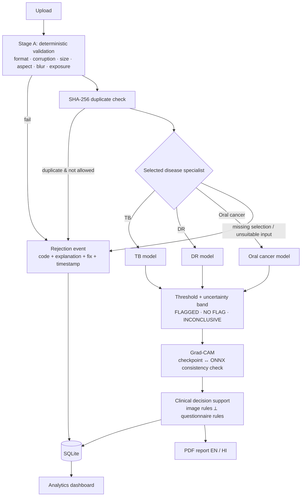

# MediScan AI

**Offline, multimodal AI screening aid for tuberculosis, diabetic retinopathy and oral cancer.**

> ⚠️ This is an experimental AI screening aid, not a medical diagnosis. Results must be reviewed by a
> qualified healthcare professional and confirmed through appropriate clinical testing.

---

## Problem

Primary-care clinics in low-resource settings see patients who need screening for tuberculosis (chest
X-ray), diabetic retinopathy (fundus photograph) and oral cancer (histopathology), but specialists are
scarce, connectivity is unreliable, and image quality varies a lot. A useful tool must work offline on a
basic laptop, reject images it cannot assess, say "I don't know" when unsure, and support the health
worker without pretending to replace the clinician.

## Solution

One local application that:

1. **Validates** every upload (format, corruption, size, aspect ratio, blur, exposure, exact duplicates).
2. **Checks suitability** with deterministic quality and coarse image-type checks; the user selects the
   disease specialist. The legacy modality classifier is not part of screening or scoring.
3. **Screens** with a disease-specific EfficientNet-B0 (ONNX Runtime, CPU), applying a validated threshold and an
   **uncertainty band** that produces `INCONCLUSIVE` instead of a forced answer.
4. **Explains** with Grad-CAM, but only when the PyTorch checkpoint provably matches the ONNX model.
5. **Suggests next steps** with transparent, rule-ID'd clinical decision support, kept separate from the model output.
6. **Records** patients (minimal data), screenings, rejections and audit events in SQLite; produces
   English/Hindi **PDF reports** and a clinic **analytics dashboard**.

## Architecture



| Layer | Location |
|---|---|
| Model registry, inference engine, preprocessing, artifact validation/import | `src/core/` |
| Image quality, selected-modality suitability, duplicate detection, rejection codes | `src/gatekeeper/` |
| TB / DR / oral specialist modules | `src/diseases/` |
| Grad-CAM + visualisation | `src/explainability/` |
| Recommendations, questionnaire rules, triage, EN/HI dictionary | `src/clinical/` |
| SQLite schema and services | `src/database/` |
| PDF reports | `src/reports/` |
| Responsive screening studio, HTTP bridge, and Gradio clinical workspace | `web/`, `src/ui/`, `app.py` |
| Training pipeline (unchanged API, now also trains the gatekeeper) | `src/data.py`, `src/train.py`, `src/evaluate.py`, `src/export_onnx.py` |

Details: [docs/ARCHITECTURE.md](docs/ARCHITECTURE.md).

## Technology stack

Python 3.13 · PyTorch + torchvision (training, Grad-CAM) · ONNX / ONNX Runtime (CPU inference) ·
Gradio 6 · Plotly · SQLite · FPDF2 + HarfBuzz shaping with Noto Sans / Noto Sans Devanagari (OFL) · pytest.

## Models

The operational baseline remains unchanged. Downloaded research candidates run
locally in a separate database with `.venv/bin/python run_pretrained.py` after
stopping the server on the same port. Research scores are not validated disease
probabilities, and failed candidates are not promoted automatically.

Current evidence and reproducible commands:
[implementation status](docs/implementation-status.md),
[model evaluation](docs/model-evaluation-report.md),
[testing report](docs/testing-report.md), and
[research setup](docs/RESEARCH_DEPLOYMENT.md).

Three binary EfficientNet-B0 specialists. A legacy three-class gatekeeper checkpoint
may be installed for historical evaluation, but is not loaded or used by screening.
Preprocessing is model-specific and recorded in each installed metadata file;
the installed specialists use exact 224×224 resizing, as described below.
Specialist outputs are reported as a **model score**, not as a probability of disease.

| Module | Architecture | Classes | Threshold | Installed version |
|---|---|---|---|---|
| TB | EfficientNet-B0 | Normal / Tuberculosis | 0.257 | `tb-aaa0b6fc` |
| DR | EfficientNet-B0 | No_DR / DR *(any grade, not "referable")* | 0.010 | `dr-4740a5c2` |
| Oral | EfficientNet-B0 | Normal / OSCC | 0.931 | `oral-ad94db8c` |
| Legacy gatekeeper (not used at runtime) | MobileNetV3-Small | chest_xray / fundus / histopathology (**no "other" class**) | — | `gatekeeper-6e0d292e` |

Models were trained externally (Gemini / Colab) and installed with
`python scripts/convert_trained_outputs.py --src trained_outputs --import`. Gemini's metadata did not
state the resize rule, output activation or gatekeeper class order, so the converter **established each
from evidence**, recorded in each `metadata.json["conversion"]`:

- **Hashes:** `model.onnx` and `best_model.pth` match Gemini's manifest.
- **Weights:** every ONNX model, including its unhashed `model.onnx.data` weights, reproduces its
  hash-verified checkpoint within ≤ 2.2e-5.
- **Preprocessing:** a direct 224×224 resize beats Resize(256)+CenterCrop(224) on all three specialists
  (accuracy at the shipped threshold: TB 0.980 vs 0.953, DR 0.893 vs 0.857, oral 0.993 vs 0.933).
- **Gatekeeper class order:** [chest_xray, fundus, histopathology], with 100% agreement on labelled images.

The bundled images used for this include training data, so those figures identify preprocessing only.
They are **not** performance results.

Artifact format, metadata schema and validation rules: [docs/MODEL_DOCUMENTATION.md](docs/MODEL_DOCUMENTATION.md).

## Datasets

150 images per class per disease are bundled under `data/` (counted). Source descriptions and known
issues (pre-filtered DR images, pre-augmented oral images, licensing) are in
[docs/DATASET_DOCUMENTATION.md](docs/DATASET_DOCUMENTATION.md).

## Setup

```bash
# Python 3.10–3.13 (3.14+ may lack torch/onnxruntime wheels)
python3.13 -m venv .venv
source .venv/bin/activate
pip install -r requirements.txt

python scripts/make_demo_assets.py      # data/samples/ (test-split images + synthetic invalid inputs)
MEDISCAN_ORT_THREADS=2 python app.py     # http://127.0.0.1:7860
```

The main page at `/` uses a responsive, charcoal-and-mint imaging studio. Upload a medical image,
select a patient (or create a demo record), run screening, inspect Grad-CAM, and export the current
measurements as CSV. Theme preference is saved locally; images and results are not saved in browser storage.
The complete Gradio clinical workspace remains at `/workspace/` for patient registration, symptom
questionnaires, English/Hindi PDF reports, records, and analytics.

The studio uses the same validation, routing, inference, explanation, and persistence pipeline as the
clinical workspace. The hero and imaging workflow use bundled chest X-ray, retinal fundus, and oral
histopathology samples. These previews show medical image types, not screening results.

Without trained models the app starts in a clearly labelled **DEMO / INCOMPLETE-MODEL** state: validation,
rejections, records, analytics and reports all work; specialist modules return a setup message.
`MEDISCAN_SIMULATION=1 python app.py` additionally lets you rehearse the full flow with **SIMULATED**
scores, which are labelled in the UI, the database and the PDF, and excluded from analytics by default.

### Installing trained models

```bash
python scripts/import_artifacts.py --archive trained_outputs.zip --dry-run   # validate only
python scripts/import_artifacts.py --archive trained_outputs.zip             # install valid models

# externally trained folder in Gemini's metadata format (what is installed now):
python scripts/convert_trained_outputs.py --src trained_outputs --out /tmp/converted.zip --import
```

The importer checks archive safety (no traversal or symlinks), verifies the SHA-256 manifest, validates
metadata, preprocessing and ONNX (structure, input shape, test inference), and installs each valid model
atomically. Invalid models leave the previous version in place.

### Configuration (environment variables)

| Variable | Default | Purpose |
|---|---|---|
| `MEDISCAN_DB` | `data/mediscan.db` | SQLite path; research launcher defaults to `output/research/mediscan.db` |
| `MEDISCAN_PROVIDER_CONFIG` | unset | Explicit local baseline/research or optional remote provider selection |
| `MEDISCAN_ARTIFACTS_DIR` | `artifacts/` | installed models |
| `MEDISCAN_RETAIN_IMAGES` | `0` | keep uploaded images (off by default for privacy) |
| `MEDISCAN_DUPLICATE_POLICY` | `reject` | `reject` or `warn` for identical files |
| `MEDISCAN_SIMULATION` | `0` | labelled simulated outputs when models are missing |
| `MEDISCAN_HOST` / `MEDISCAN_PORT` | `127.0.0.1` / `7860` | server binding |
| `MEDISCAN_ORT_THREADS` | ORT default | ONNX Runtime intra-op threads |

Image-quality thresholds live in `config.QUALITY` (see [docs/ARCHITECTURE.md](docs/ARCHITECTURE.md#image-quality-thresholds)).

## Training workflow

On Colab (T4), open [`train_colab.ipynb`](train_colab.ipynb), or run:

```bash
python -m src.train --disease tb          # also: dr, oral, gatekeeper
python -m src.evaluate --disease tb       # threshold chosen on VALIDATION split (target sensitivity 0.95)
python -m src.export_onnx --disease tb
python scripts/package_artifacts.py --out trained_outputs.zip   # writes metadata.json + manifest
```

## Evaluation metrics

These metrics were **reported by the external (Gemini/Colab) training pipeline** on its own held-out split
(`trained_outputs/results/*/metrics.json`). MediScan did **not** re-measure them, and the split is not
available for independent checking.

| Reported metric | TB | DR | Oral | Gatekeeper |
|---|---|---|---|---|
| Test images | 45 | 44 | 44 | not reported |
| AUC (95% CI) | 0.980 (0.922–1.000) | 1.000 (1.000–1.000) | 1.000 (1.000–1.000) | not reported |
| Accuracy @ threshold | 0.956 | 0.841 | 1.000 | not reported |
| Sensitivity / specificity | 0.947 / 0.962 | 1.000 / 0.767 | 1.000 / 1.000 | — |

**Read with caution:**
- The test sets have about 45 images each.
- The DR threshold of **0.01** pushes sensitivity to 1.0 at the cost of specificity, so expect many DR flags.
- AUC = 1.000 for DR and oral is implausibly perfect. It likely reflects the tiny test sets and, for
  oral, near-duplicate augmented images (`aug_*`) shared between splits.
- None of these numbers are clinical validation.

## CPU benchmark (measured)

`python scripts/benchmark_cpu.py --runs 50` on an Apple M2 (8 GB RAM), macOS, Python 3.13, ONNX Runtime 1.31,
with a **randomly initialised** EfficientNet-B0 because no trained models are installed. Latency does not
depend on weight values.

| Step | Median | p90 |
|---|---|---|
| Preprocessing (512 px PNG → tensor) | 5.1 ms | — |
| ONNX inference, batch 1 | 31.1 ms | 57.8 ms |
| ONNX session load (once, cached) | 135 ms | — |
| Model file size | 15.9 MB | — |

With the installed models, end-to-end screening of the sample images (validation + selected specialist +
specialist, excluding Grad-CAM) measured **42–146 ms** per image on the same machine.

Grad-CAM (PyTorch, CPU, same machine) measured 3.9 s on the first call (including import and loading
of the PyTorch model) and a 0.73 s warm median over 5 calls. It can be switched off per screening.
Re-run the benchmark on the target clinic laptop.

## Tests

```bash
.venv/bin/python -m pytest -q
.venv/bin/python scripts/verify_local_pretrained.py --out output/pretrained-verification.json
.venv/bin/python scripts/verify_launchers.py --out output/launcher-verification.json
```

They cover validation, corrupt and duplicate images, specialist selection, missing, invalid and corrupt models,
preprocessing parity with torchvision, thresholds and uncertainty, invalid outputs, Grad-CAM failure modes,
recommendations, EN/HI completeness, SQLite services, analytics, PDFs, safe archive import, the
packager↔importer contract, and end-to-end workflows. Test models are **tiny synthetic ONNX graphs**
with fixed outputs. They test software behaviour only, never medical performance.

## Screenshots

| Overview | New screening | Analytics |
|---|---|---|
| *(add `docs/img/overview.png`)* | *(add `docs/img/screening.png`)* | *(add `docs/img/analytics.png`)* |

## Limitations

Small public datasets (150 images per class), no external or prospective validation, uncalibrated scores,
a DR dataset that is pre-filtered and labelled "any DR" rather than "referable DR", pre-augmented oral
images with possible leakage across splits, questionnaire rules and Hindi text pending clinician review.
Full list: [docs/CLINICAL_LIMITATIONS.md](docs/CLINICAL_LIMITATIONS.md).

## Responsible AI

- Screening aid only. It never diagnoses, prescribes or recommends treatment.
- Abstains (`INCONCLUSIVE`) near the threshold, on out-of-distribution input, or on invalid output.
- A "no flag" result is always worded as *not ruling out disease*.
- Questionnaire rules are shown with rule IDs and never merged into a "combined probability".
- Ordinary uploaded scans are not retained by default. Saved demo names/scans and named PDF snapshots
  are retained locally. Default inference makes no external requests; remote providers require explicit
  configuration. SQL is parameterised and actions are audited.
- No fabricated metrics. Simulated outputs are labelled everywhere.

## Demo

Two-minute script: [docs/DEMO_GUIDE.md](docs/DEMO_GUIDE.md).
